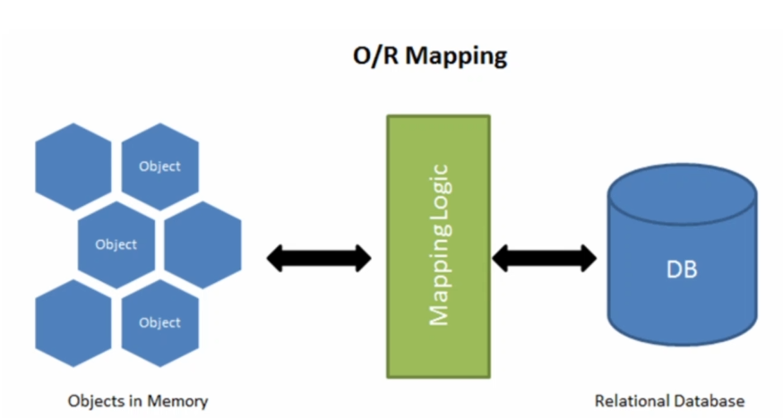
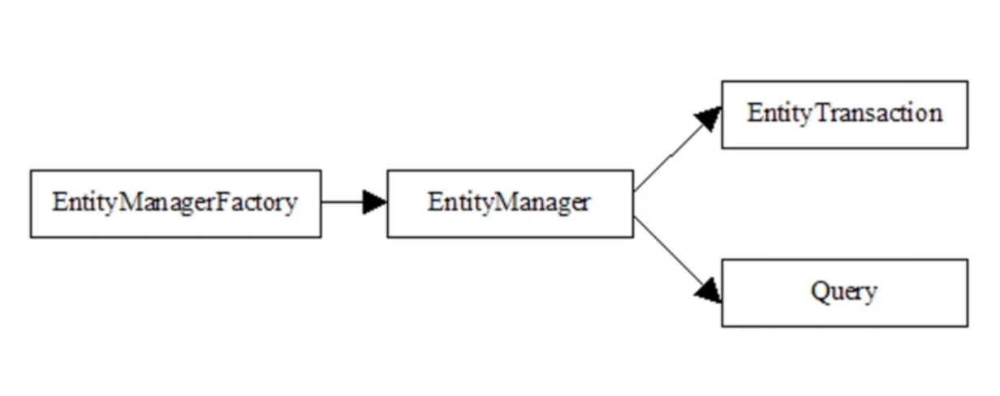

# Object Relational Mapping (ORM)
##  Overview



**Object Relational Mapping is Process of converting objects to database tables. In other words this allows us to interact with the relational database without any SQL. ORM is a programming technique to map application domain model objects to the relational database tables.**

*In ORM object will map to table column*

## JPA
JPA stands for Jakarta Persistence API, formerly known as Java Persistence API.

JPA is a specification that defines how to persist data in java applications. **it is not a library!** it is just a specification set of interfaces. it is contracts that should be followed when you want to use Persistence API in java applications.

### ORM Providers

**Persistence Providers:**
- Hibernate
- EclipseLink
- Oracle TopLink
- Apache OpenJPA
- Apache iBatis


**_ORM_:** Concept/Process of converting the data from Object Oriented Language to relational Database.

**_JPA_:** Standard Specification for ORM. can be used as abstraction for different ORM frameworks.

**_Hibernate_:** Implementation of JPA and ORM concepts.

---

### Entities in JPA
**Enity**: a lightweight persistence domain object. typically, an entity represents a table in relational database, and each entity instance corresponds to a row in that table.

```java
import jakarta.persistence.Entity;

@Entity
public class Client {
}
```
*`@Entity` Annotation is from `jakarta.persistence` package*

By default this class will map to Client table as determined by the given class name. But if you wanted to map an entity to a table with different name you can use `@Table` Annotation.

```java
import jakarta.persistence.Entity;
import jakarta.persistence.Table;

@Entity
@Table(name = "clients")
public class Client {
}
```

Each field of the class will map to a column of the table.
you can map fields to columns with different names using `@Column` Annotation

```java
import jakarta.persistence.Column;
import jakarta.persistence.Entity;
import jakarta.persistence.Table;

@Entity
@Table(name = "clients")
public class Client {
  private String name;
  @Column(name = "legal_name")
  private String legalName;
```

`@Column` annotation also allows to specify other method information about the mapping. Namely, we can specify the value of some should be *UNIQUE*
```java
@Column(name = "legal_name", unique = true)
private String legalName;
```

We Use `@ID` annotation to designate the field to be the table's primary key
```java
@Id
@GeneratedValue(strategy = GenerationType.IDENTITY)
private Integer id;
```

### Composite Primary Key

A **Composite Primary Key** is a primary key that consists of two or more columns. Instead of using a single field as the primary key, multiple fields together uniquely identify an entity.

For example, consider a `project_members` table where the combination of `project_id` and `member_id` must be unique:

```text
project_members
-------------------------
project_id
member_id
role
```

In JPA, there are two common ways to define a composite primary key:

* `@IdClass`
* `@EmbeddedId`

#### Using `@IdClass`

With `@IdClass`, the entity contains multiple fields annotated with `@Id`, and a separate key class represents the composite key.

```java
@Entity
@Table(name = "project_members")
@IdClass(ProjectMemberId.class)
public class ProjectMember {

    @Id
    private Integer projectId;

    @Id
    private Integer memberId;

    private String role;
}
```

The composite key class:

```java
import java.io.Serializable;

public class ProjectMemberId implements Serializable {

    private Integer projectId;
    private Integer memberId;

    // equals() and hashCode()
}
```

The fields in the `@IdClass` must correspond to the fields annotated with `@Id` in the entity.

#### Using `@EmbeddedId`

With `@EmbeddedId`, the composite key is represented by a separate class annotated with `@Embeddable`.

```java
import jakarta.persistence.Embeddable;

@Embeddable
public class ProjectMemberId {

    private Integer projectId;
    private Integer memberId;

    // equals() and hashCode()
}
```

Then the key class is embedded into the entity:

```java
@Entity
@Table(name = "project_members")
public class ProjectMember {

    @EmbeddedId
    private ProjectMemberId id;

    private String role;
}
```

The `@EmbeddedId` approach treats the composite key as a single value object, while `@IdClass` keeps the individual key fields directly inside the entity.

In both approaches, the composite key class should implement `Serializable` and must properly implement `equals()` and `hashCode()` because JPA uses the identity of the key to determine whether two entity instances represent the same database row.

### `@IdClass` vs `@EmbeddedId`

|                      | `@IdClass`                       | `@EmbeddedId`                                 |
| -------------------- | -------------------------------- | --------------------------------------------- |
| Composite key fields | Directly inside the entity       | Inside a separate key object                  |
| Entity structure     | Fields are exposed directly      | Key is represented by one `@EmbeddedId` field |
| Key class            | Separate class                   | Separate `@Embeddable` class                  |
| Accessing fields     | `entity.getProjectId()`          | `entity.getId().getProjectId()`               |
| Main idea            | Entity has multiple `@Id` fields | Entity has one embedded composite key         |

**In short:**

* `@IdClass` → composite key fields are part of the entity.
* `@EmbeddedId` → composite key is encapsulated in a separate object.

Both approaches are valid JPA solutions for defining a composite primary key.

### `@Transient`

The `@Transient` annotation is used to specify that a field should **not be persisted** in the database.

Normally, JPA maps entity fields to database columns. But sometimes an entity contains fields that are calculated or used only within the application and should not be stored in the database.

```java
@Entity
public class Client {

    private String firstName;
    private String lastName;

    @Transient
    private String fullName;
}
```

In this example, `firstName` and `lastName` are mapped to database columns, but `fullName` is not mapped to any column.

The value of `fullName` can be calculated in the application:

```java
@Transient
private String fullName;

public String getFullName() {
    return firstName + " " + lastName;
}
```

`@Transient` is different from Java's `transient` keyword. `@Transient` is a JPA annotation that tells the persistence provider not to persist the field.

---

### `@Enumerated`

The `@Enumerated` annotation is used to specify how an Java `enum` should be persisted in the database.

For example:

```java
public enum ClientStatus {
    ACTIVE,
    INACTIVE
}
```

We can use the enum in an entity:

```java
@Enumerated(EnumType.STRING)
private ClientStatus status;
```

There are two ways to persist an enum:

#### `EnumType.STRING`

Stores the name of the enum constant as a string.

```java
@Enumerated(EnumType.STRING)
private ClientStatus status;
```

For example:

```text
ACTIVE
INACTIVE
```

This is generally the preferred approach because it is more readable and safer if the order of enum constants changes.

#### `EnumType.ORDINAL`

Stores the position of the enum constant as a number.

```java
@Enumerated(EnumType.ORDINAL)
private ClientStatus status;
```

For example:

```java
public enum ClientStatus {
    ACTIVE,    // 0
    INACTIVE   // 1
}
```

The database would store:

```text
0
1
```

`EnumType.ORDINAL` is generally not recommended because changing the order of enum constants can change the meaning of existing data.

For example, if the enum changes from:

```java
ACTIVE,
INACTIVE
```

to:

```java
PENDING,
ACTIVE,
INACTIVE
```

the value `0` in existing database records would now represent `PENDING` instead of `ACTIVE`.

Therefore, for most applications:

```java
@Enumerated(EnumType.STRING)
private ClientStatus status;
```

is the preferred approach.


### `persistence.xml`

`persistence.xml` is a standard JPA configuration file used to define a **Persistence Unit** and configure the JPA persistence environment.

It is normally located at:

```text
src/main/resources/META-INF/persistence.xml
```

A simple example:

```xml
<persistence xmlns="https://jakarta.ee/xml/ns/persistence"
             version="3.1">

    <persistence-unit name="myPersistenceUnit">

        <provider>
            org.hibernate.jpa.HibernatePersistenceProvider
        </provider>

        <class>com.example.Client</class>

        <properties>
            <property name="jakarta.persistence.jdbc.url"
                      value="jdbc:postgresql://localhost:5432/mydb"/>

            <property name="jakarta.persistence.jdbc.user"
                      value="postgres"/>

            <property name="jakarta.persistence.jdbc.password"
                      value="password"/>
        </properties>

    </persistence-unit>

</persistence>
```

The `persistence-unit` defines a persistence context configuration, including the JPA provider, entity classes, database connection, and other persistence properties.

The JPA provider, such as Hibernate, uses this configuration to create an `EntityManagerFactory`, which is then used to create `EntityManager` instances.

```text
persistence.xml
       │
       ▼
Persistence Unit
       │
       ▼
EntityManagerFactory
       │
       ▼
EntityManager
       │
       ▼
Persistence Context
       │
       ▼
Database
```

### `persistence.xml` in Spring Boot

Although `persistence.xml` is still part of the JPA specification and is **not deprecated**, it is usually not required in Spring Boot applications.

Spring Boot provides auto-configuration for JPA and Hibernate and typically uses `application.properties` or `application.yml` for configuration.

For example:

```properties
spring.datasource.url=jdbc:postgresql://localhost:5432/mydb
spring.datasource.username=postgres
spring.datasource.password=password

spring.jpa.hibernate.ddl-auto=validate
```

### `spring.jpa.hibernate.ddl-auto`

This property specifies how Hibernate should handle the database schema when the application starts.

```properties
spring.jpa.hibernate.ddl-auto=validate
```

Common values:

| Value         | Description                                                           |
| ------------- | --------------------------------------------------------------------- |
| `none`        | Hibernate does nothing with the database schema                       |
| `validate`    | Checks that entity mappings match the database schema                 |
| `update`      | Attempts to update the schema based on entity mappings                |
| `create`      | Creates the schema from scratch                                       |
| `create-drop` | Creates the schema at startup and drops it when the application stops |

For applications where the database schema is managed separately, `validate` is a good choice:

```properties
spring.jpa.hibernate.ddl-auto=validate
```

It makes Hibernate **validate the existing schema without modifying it**.

For production applications, it is generally better to manage database schema changes using migration tools such as **Flyway** or **Liquibase**, rather than relying on `ddl-auto=update`.


Spring Boot automatically configures the necessary components:

```text
DataSource
    │
    ▼
EntityManagerFactory
    │
    ▼
EntityManager
    │
    ▼
Hibernate
    │
    ▼
Database
```

Therefore, in a typical Spring Boot application, you **do not need to create a `persistence.xml` file manually**.

`persistence.xml` is still useful when working with JPA directly in a standalone application, or when working with an existing application that explicitly uses a JPA persistence unit.

**In short:**

* `persistence.xml` → Standard JPA configuration mechanism.
* `application.properties/yml` → Common configuration approach in Spring Boot.
* Spring Boot automatically configures JPA and Hibernate, so `persistence.xml` is usually unnecessary.


### EntityManager


`EntityManager` is the main interface in JPA used to **manage the lifecycle of entities** and interact with the persistence context.

It provides methods for performing operations such as:

* Persisting new entities
* Finding existing entities
* Updating entities
* Removing entities
* Managing the persistence context

The `EntityManager` is part of the JPA specification and is provided by the JPA implementation, such as Hibernate.

```java
import jakarta.persistence.EntityManager;
```

#### Persistence Context

The **Persistence Context** is a collection of entity instances that are currently managed by an `EntityManager`.

When an entity is managed by the persistence context, JPA automatically tracks changes made to that entity and can synchronize those changes with the database.

For example:

```java
Client client = entityManager.find(Client.class, 1);
client.setName("John");
```

We did not explicitly execute an `UPDATE` statement. Because `client` is a managed entity, JPA detects the change and generates the appropriate SQL when the persistence context is synchronized with the database.

---

### Entity Lifecycle

An entity can have different states during its lifecycle:

```text
Transient → Managed → Detached
                ↓
             Removed
```

**Transient**

The object has been created with `new`, but it is not associated with a persistence context.

```java
Client client = new Client();
```

**Managed**

The entity is associated with an `EntityManager` and is tracked by the persistence context.

```java
entityManager.persist(client);
```

Changes to a managed entity are automatically tracked by JPA.

**Detached**

The entity was previously managed, but it is no longer associated with the persistence context.

For example, this can happen after the persistence context is closed.

**Removed**

The entity is marked for deletion from the database.

```java
entityManager.remove(client);
```

---

### Common EntityManager Methods

#### `persist()`

Makes a new entity managed and schedules it to be inserted into the database.

```java
Client client = new Client();

entityManager.persist(client);
```

This is normally used for **new/transient entities**.

#### `find()`

Retrieves an entity by its primary key.

```java
Client client = entityManager.find(Client.class, 1);
```

If the entity exists, JPA returns the managed entity. Otherwise, it returns `null`.

#### `remove()`

Marks a managed entity for deletion.

```java
Client client = entityManager.find(Client.class, 1);

entityManager.remove(client);
```

The corresponding `DELETE` statement will be executed when the persistence context is synchronized with the database.

#### `merge()`

Used to copy the state of a detached entity into a managed entity.

```java
Client managedClient = entityManager.merge(client);
```

The returned object is the managed instance.

It is important to note that `merge()` does **not** make the original object managed. It returns a managed copy.

#### `flush()`

Synchronizes the persistence context with the database.

```java
entityManager.flush();
```

This causes pending SQL operations such as `INSERT`, `UPDATE`, or `DELETE` to be sent to the database.

`flush()` does not necessarily commit the transaction.

---

### EntityManager and Hibernate

`EntityManager` is part of the **JPA specification**, while Hibernate provides the implementation behind it.

```text
JPA
 │
 └── EntityManager
       │
       ▼
   Hibernate
       │
       ▼
   Database
```

This means application code can use the standard JPA `EntityManager` API without directly depending on Hibernate-specific APIs.

For example:

```java
@PersistenceContext
private EntityManager entityManager;
```

The persistence provider, such as Hibernate, provides the actual implementation of `EntityManager`.

In Spring applications, `EntityManager` is usually managed and injected by Spring, so developers generally do not create it manually.


